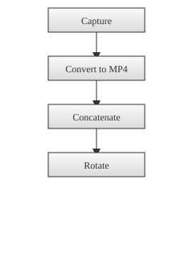

# Video Archiver

The video archiver compiles screenshots into MP4 segments using FFmpeg. Output
files are rotated when they grow too large or when their creation date exceeds
`MAX_COMPRESSED_VIDEO_AGE` days. FFmpeg stdout and stderr are logged to aid
troubleshooting.

The pipeline below summarizes this process:

Concatenation now uses FFmpeg's **concat demuxer** with `-c copy` so that
existing segments are joined without re-encoding. This keeps the CPU overhead
low and preserves the original image quality.

Errors encountered during compilation are logged with the camera name so that
failures can be diagnosed easily.

Blank screenshots (identified by the `_blank.png` suffix or when the image is
mostly empty) are discarded before any compilation step. This keeps videos free
of placeholder frames.

If a screenshot vanishes between discovery and metadata lookup (for example, if
another process cleans the directory), the archiver simply skips that file. This
prevents crashes due to `FileNotFoundError` when gathering timestamps.

When segments are concatenated, the resulting `in_process.mp4` is checked to
ensure its modification time is recent. A stale timestamp triggers a warning
and the operation is aborted so corrupted videos do not linger. The
concatenation now uses FFmpeg's `concat` demuxer with `-c copy` so existing
segments are merged without re-encoding.

Videos automatically rotate into a `final_*.mp4` once roughly 600 frames
(about 24 seconds) accumulate. A small tolerance in the duration check prevents
rounding errors from delaying rotation.

Frames are streamed to FFmpeg via `image2pipe`, which avoids writing
intermediate PNG files. The resize filter runs before encoding and temporary
segments are concatenated with the `concat` demuxer using `-c copy` so the
encoded H.264 streams are preserved.

## Frame preparation and validation

Archive candidates share one combined PNG integrity/content check. Pillow verifies
chunk integrity, then loads pixels once for the existing blank-frame classifier.
The bounded metadata cache retains only booleans, never decoded images. Before
encoding, file identity is checked again; replacement, editing, deletion, or
a change during validation rejects or revalidates the result. Fresh files bypass
the cache. Corrupt frames do not consume the newest-300 valid-frame budget.

Capture cadence, classifier thresholds, encoder settings, and source recordings
are unchanged. A bounded six-frame profile on 2026-11-16 measured about 30% less
CPU time for combined preparation than separate content and validity checks.
This convenience sample used warm caches and fixed stage order; it is not an
estimate of whole-service CPU reduction or measured wall-power savings.
